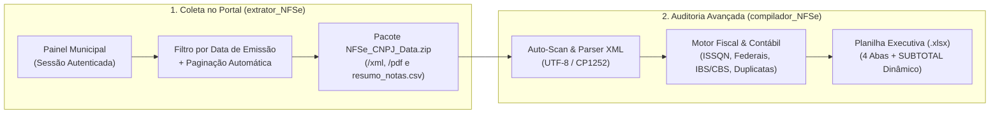

# 📊 Suíte NFS-e Nacional: Extrator em Lote (Extensão) & Compilador Fiscal (`XML` $\rightarrow$ `Excel Dinâmico`)


[-Extrator__NFSe.zip-0F3566?style=for-the-badge&logo=googlechrome&logoColor=white)](https://github.com/icaro-arch/compilador_NFSe/raw/main/extrator_NFSe/Extrator_NFSe.zip)
[-Compilador__NFSe.exe-1B6B53?style=for-the-badge&logo=windows&logoColor=white)](https://github.com/icaro-arch/compilador_NFSe/raw/main/compilador_NFSe/Compilador_NFSe.exe)

Solução ponta a ponta para **coleta automatizada em lote** e **auditoria fiscal/contábil** de **Notas Fiscais de Serviços Eletrônicas (NFS-e)** no **Padrão Nacional SPED (`nfse.gov.br`)**, organizada em dois módulos principais de igual protagonismo:

| Módulo | Diretório | Download Direto | Função Principal |
| :--- | :--- | :--- | :--- |
| **1. 🧩 Extrator NFS-e** *(Extensão Manifest V3)* | [`extrator_NFSe/`](./extrator_NFSe) | **[📥 `Extrator_NFSe.zip`](https://github.com/icaro-arch/compilador_NFSe/raw/main/extrator_NFSe/Extrator_NFSe.zip)** | Filtra por **Data de Emissão**, percorre a paginação automaticamente e baixa lotes de **XML**, **PDF (DANFSe)** e **Planilha Resumo (`.csv`)** em `.zip` no Painel Municipal. |
| **2. 📊 Compilador NFS-e** *(Desktop Windows / Python)* | [`compilador_NFSe/`](./compilador_NFSe) | **[📥 `Compilador_NFSe.exe`](https://github.com/icaro-arch/compilador_NFSe/raw/main/compilador_NFSe/Compilador_NFSe.exe)** | Lê lotes de arquivos `.xml` (ou `.csv` do ADN) e gera pastas de trabalho **Excel (`.xlsx`)** executivas com **4 abas**, **70 colunas** e **somas dinâmicas sob filtro (`SUBTOTAL`)**. |

---

## 📁 Organização do Repositório

```text
📦 compilador_NFSe/
├── 📁 extrator_NFSe/                   # MÓDULO 1: Extensão de Navegador (Chrome / Edge / Brave)
│   ├── Extrator_NFSe.zip               # Pacote pronto para baixar e carregar no navegador
│   ├── manifest.json                   # Configuração Manifest V3
│   ├── lib/jszip.min.js                # Compactação em memória
│   ├── src/                            # Scraper, Filtro de Datas, Parser XML e Fila de Download
│   └── README.md                       # Guia dedicado da Extensão
│
├── 📁 compilador_NFSe/                 # MÓDULO 2: Compilador Fiscal (XML/CSV -> Excel Dinâmico)
│   ├── Compilador_NFSe.exe             # Executável standalone para Windows (sem instalar Python)
│   ├── compilar_nfse.py                # Código-fonte completo (GUI Tkinter + CLI + Motor OpenPyXL)
│   ├── Iniciar_Compilador_NFSe.bat     # Atalho de inicialização rápida
│   ├── requirements.txt                # Dependências Python
│   ├── examples/                       # XML demonstrativo no padrão SPED v1.01
│   └── README.md                       # Guia dedicado do Compilador
│
├── .gitignore                          # Blindagem de sigilo fiscal (ignora lotes reais)
├── LICENSE                             # Licença MIT
└── README.md                           # Documentação Geral da Suíte
```

---

## 🏗️ Fluxo Integrado (Ponta a Ponta)



---

## 🧩 Módulo 1: Extrator NFS-e ([`extrator_NFSe/`](./extrator_NFSe))

O Portal da NFS-e não possui função nativa para baixar todas as notas de um período de uma só vez. A extensão **Extrator NFS-e** injeta um painel flutuante em `https://www.nfse.gov.br/PainelMunicipal/NFSe/Consulta` para realizar a coleta em lote sem precisar clicar nota por nota.

### Principais Recursos do Extrator:
- **Autenticação Transparente (`Session Inheritance`):** Reaproveita sua sessão já logada (Certificado Digital A1/A3 ou Gov.br) sem nunca solicitar senhas ou chaves privadas.
- **Filtro por Data de Emissão com Parada Inteligente (*Early Stop*):**
  - Campo **"De" (Data Inicial):** Inicia em `"Desde sempre"` e permite escolher uma data específica no calendário (com botão `×` para limpar).
  - Campo **"Até" (Data Final):** Preenchido automaticamente com a data de hoje.
  - **Early Stop:** Lê a coluna de Data de Emissão linha a linha e **interrompe a paginação automaticamente** assim que alcança páginas anteriores à data inicial escolhida.
- **Nomeação Automática por CPF/CNPJ:** Detecta o CPF/CNPJ consultado na página e sugere automaticamente `NFSe_{CPF_OU_CNPJ}_{DATA}` em um campo editável.
- **Alta Velocidade & Compactação `.ZIP` em Memória:** Fila paralela otimizada (`2x` simultâneos com intervalo de `100 ms` e *retry* automático) que empacota `/xml`, `/pdf` e `resumo_notas.csv` em um único download `.zip`.

### Como Instalar a Extensão no Chrome / Edge / Brave:
1. **[📥 Baixe o `Extrator_NFSe.zip`](https://github.com/icaro-arch/compilador_NFSe/raw/main/extrator_NFSe/Extrator_NFSe.zip)** e extraia em uma pasta no seu computador *(ou utilize diretamente a pasta `extrator_NFSe` se clonou o repositório)*.
2. No navegador, acesse `chrome://extensions/` (ou `edge://extensions/`).
3. Ative a chave **Modo do desenvolvedor** (*Developer mode*) no canto superior direito.
4. Clique em **Carregar sem compactação** (*Load unpacked*) e selecione a pasta [`extrator_NFSe`](./extrator_NFSe).
5. Clique no ícone da extensão na barra do navegador para abrir diretamente `https://www.nfse.gov.br/PainelMunicipal/NFSe/Consulta`.

---

## 🚀 Módulo 2: Compilador de NFS-e ([`compilador_NFSe/`](./compilador_NFSe))

Para gerar a auditoria fiscal completa em Excel (`.xlsx`) a partir dos XMLs baixados no Windows, **não é necessário instalar Python nem nenhuma biblioteca**:

### Passo a Passo Rápido:
1. **Baixe o programa:**
   - 👉 **[📥 Clique aqui para baixar o `Compilador_NFSe.exe`](https://github.com/icaro-arch/compilador_NFSe/raw/main/compilador_NFSe/Compilador_NFSe.exe)**
2. **Abra o aplicativo:** Dê dois cliques no arquivo `Compilador_NFSe.exe` baixado *(caso o Windows exiba o aviso padrão do SmartScreen, clique em "Mais informações" → "Executar assim mesmo")*.
3. **Escolha a pasta de XMLs ou o arquivo `.CSV` (ADN):** Clique em **"Procurar Pasta..."** (para selecionar a pasta `xml/` extraída do `.zip` ou qualquer pasta com notas em `.xml`) ou em **"Selecionar CSV / XML..."** (para selecionar um arquivo `.csv` exportado do Ambiente de Dados Nacional — ADN com XMLs embutidos).
   - O programa fará a leitura instantânea das notas e **sugerirá automaticamente o nome do arquivo Excel** com base na empresa e competência identificadas.
4. **Gere a planilha:** Clique no botão verde **"▶ COMPILAR NOTAS E GERAR EXCEL"** e, em seguida, em **"📊 Abrir Planilha no Excel"**.

---

## 🎯 Principais Diferenciais do Compilador Excel

- **Interface Gráfica (`Tkinter`) com Pré-Leitura Inteligente (Auto-Scan):**
  - Ao selecionar uma pasta com arquivos `.xml`, o sistema inspeciona automaticamente o lote em milissegundos, exibindo quantidade de notas válidas, empresa principal, fornecedores distintos, competência e valor bruto total.
- **Somas e Contagens Dinâmicas Reativas a Filtros (`SUBTOTAL`):**
  - Todas as **15 colunas financeiras e tributárias** utilizam `=SUBTOTAL(109, ...)` e `=SUBTOTAL(103, ...)`. Ao filtrar qualquer critério no Excel, todas as somas de ISSQN, INSS, IRRF, CSLL, PIS, COFINS, IBS, CBS, Valor Bruto e Valor Líquido recalculam instantaneamente.
- **Reorganização Funcional de 70 Colunas + Grupos Retráteis (`+` / `-`):**
  - 4 abas estruturadas (`Resumo Financeiro Consolidado`, `Notas Fiscais`, `Resumo por Fornecedor` e `Resumo por Município`) com *Outline Grouping* nativo do Excel.

---

## 🛠️ Para Desenvolvedores (Execução via Código-Fonte Python)

Caso deseje modificar o código-fonte ([`compilador_NFSe/compilar_nfse.py`](compilador_NFSe/compilar_nfse.py)) ou executar diretamente pelo Python:

```bash
cd compilador_NFSe
pip install -r requirements.txt
python compilar_nfse.py
```

Para executar via Linha de Comando (CLI):
```bash
cd compilador_NFSe
python compilar_nfse.py --cli --input "examples" --output "demonstracao_nfse.xlsx"
```

---

## 🔒 Privacidade e Sigilo Fiscal (`.gitignore`)

Este repositório está configurado por padrão para **ignorar qualquer arquivo `.xml` real, pastas de lotes fiscais e planilhas `.xlsx`/`.csv` geradas**, garantindo que nenhum dado sensível de contribuintes seja versionado acidentalmente. Apenas o arquivo fictício em [`compilador_NFSe/examples/exemplo_nfse_nacional.xml`](compilador_NFSe/examples/exemplo_nfse_nacional.xml) é incluído para fins de demonstração.

---

## 👤 Autor

Desenvolvido por **Icaro** ([`@icaro-arch`](https://github.com/icaro-arch)).
